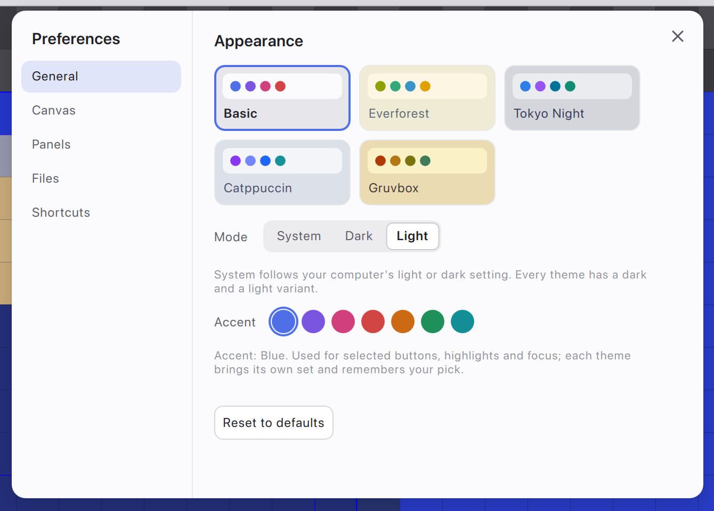

# Themes and preferences

Open **Preferences** with <kbd>Ctrl</kbd> + <kbd>,</kbd> (on a Mac: **Smalto → Preferences…**, <kbd>Cmd</kbd> + <kbd>,</kbd>). It has five sections: **General**, **Canvas**, **Panels**, **Files** and **Shortcuts**.

## General: appearance

- **Theme:** five families, each with a dark and a light variant and its own set of accent colors: **Basic**, **Everforest**, **Tokyo Night**, **Catppuccin** and **Gruvbox**. Each card previews the window, a panel and four accents.
- **Mode:** **System** follows your computer's light or dark setting, **Dark** and **Light** force one.
- **Accent:** the color of selected buttons, highlights and focus. Each theme remembers its own pick.

The colors of your sprite are never affected by the theme.

## Canvas

- **Checkerboard:** the pattern behind transparent pixels. **Colors**: Dark, Light, Gray or Custom, or **Match the theme**. **Fixed on screen** keeps the cells one size and place while you zoom and pan, instead of belonging to the picture; **Cell size** sets their size.
- **Tiled view:** how many **Copies** show around the sprite, and whether to **Dim the copies** so the original stays clear. (The tiled view is a button in the status bar: it repeats the sprite around itself to check that seams match.)
- **Grids:** the **Pixel grid** and the **Document grid** colors (written `#rrggbbaa`: the alpha is the strength), and **Automatic** colors that adapt to the picture.
- **Trackpad scrolling:** whether a two-finger scroll **Pans** or **Zooms**.
- **Grid for new sprites:** the grid cell size new sprites start with. Each sprite keeps its own grid in its file; change it from the grid button in the status bar.

## Panels

**Show** chooses which panels appear, and **Layout** sets the panel **Style** (Floating or Docked), the **Tool columns** and **Reset panel layout**. See [Panels and layout](panels.md).

## Files

- **Startup → Reopen files:** open the files that were open when Smalto last quit.
- **Crash recovery → Copy after:** how many seconds after you stop editing an unsaved sprite is copied aside (0 turns it off).
- **Undo history → Memory per sprite:** how much memory a sprite's undo history may use (0 is unlimited).

## Shortcuts

See [Shortcuts](shortcuts.md).

## Reset to defaults

Each section ends with **Reset to defaults**, which returns just that section's settings.
