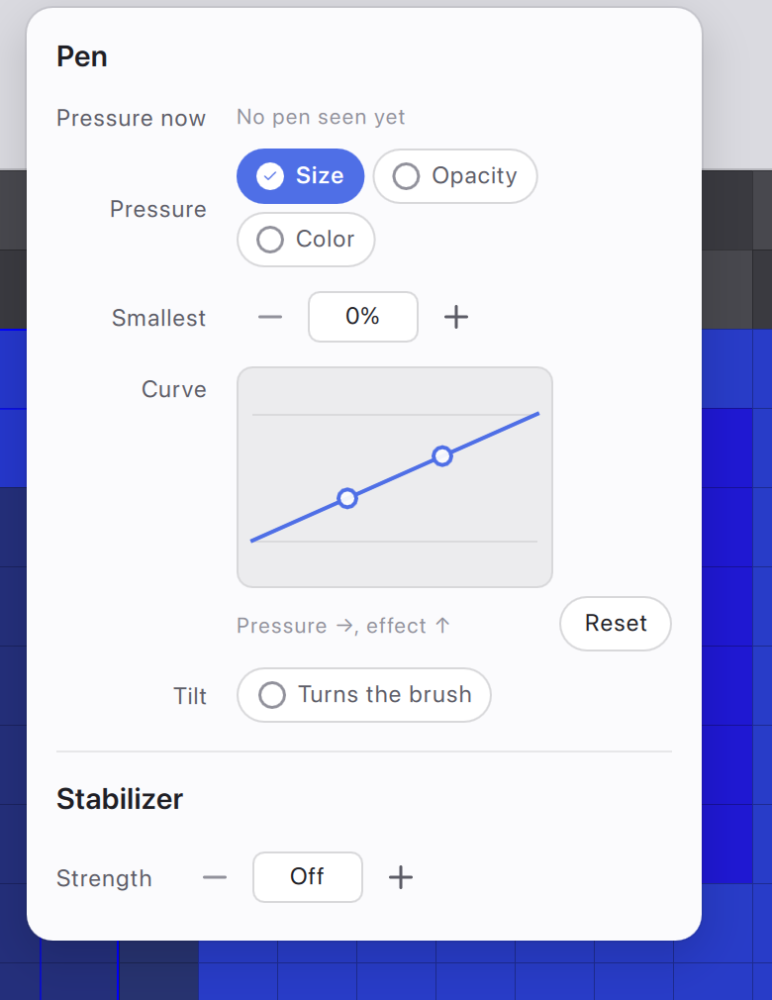

# Brushes and pens

The pencil, eraser, blur and jumble tools share a brush. Its options are at the left of the options strip.

## Size, shape and angle

- **Size:** the **−** / **+** buttons and the field, or <kbd>[</kbd> and <kbd>]</kbd>. You can also hold <kbd>Ctrl</kbd> + <kbd>Alt</kbd> (on a Mac: physical <kbd>Control</kbd> + <kbd>Option</kbd>) and drag sideways on the canvas.
- **Shape:** square, round, or a custom brush (the third button, which shows the brush itself).
- **Angle:** turns the square and custom brushes (the round one looks the same at any angle). Hold <kbd>Shift</kbd> while dragging the angle field for 15° steps; <kbd>Ctrl</kbd> + <kbd>Alt</kbd> + <kbd>Shift</kbd> + drag sets it on the canvas.

## Pixel perfect

For 1-pixel strokes, **Pixel perfect** removes the extra corner pixels where a freehand stroke steps diagonally, so lines stay one pixel thin. It applies to the pencil and eraser at size 1, and also keeps diagonals one cell thin when painting tiles.

## Custom brushes

1. Select some pixels (or none, to use the whole layer).
2. Press <kbd>Ctrl</kbd> + <kbd>B</kbd> (**Brush from selection**), or click the brush button in the selection tools' options.
3. The third shape button now shows your brush. Click it.

With a custom brush selected you can:

- **Scale** it with the scale field (negative values shrink it), and **flip** it from the flip menu. A **Reset** button appears when you changed the scale or flips.
- Choose **Brush colors** (the brush paints in its own colors) or **Color** (the brush is a stencil painted in the primary color).
- Turn on **Blend** to lay the brush's semi-transparent pixels over what is there instead of replacing it (RGBA sprites).

### The brush library

The chevron next to the shape buttons opens the **Brushes** library. **Save current** keeps the current custom brush; click a saved brush to use it, and the **×** on a saved brush removes it. Saved brushes stay between sessions.

## Pen and tablet

If you use a drawing tablet, the **Pen** button (the pen-nib icon at the right of the strip, for the pencil, eraser, blur and jumble) opens the pen settings:

- **Pressure** can drive the brush **Size**, the **Opacity**, or the **Color** (light pressure paints the secondary color, firm pressure the primary). Turn on any combination.
- **Smallest** is the brush size at the lightest press, as a part of the full size (never under 1 px).
- **Curve** shapes the response: drag points on the line (pressure runs left to right, the effect bottom to top). **Reset** returns it to a straight line.
- **Tilt → Turns the brush:** the brush turns the way the pen leans, on top of the brush angle (square and custom brushes).
- **Pressure now** shows the pressure it sees; it says "No pen seen yet" until you touch the tablet.

### Stabilizer

The stabilizer works with a mouse as well as a pen. **Strength** is the length of a "string" the brush trails the pointer on: shaky moves within it don't paint, and curves come out smooth. At **Off** it does nothing.
