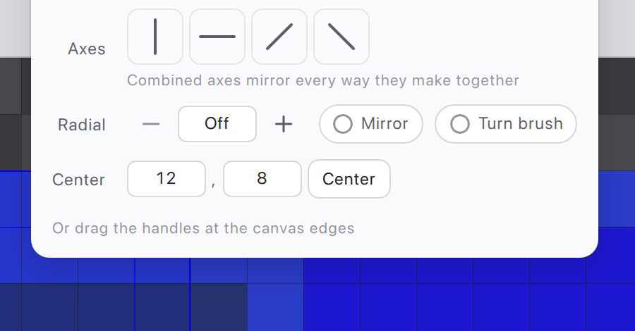
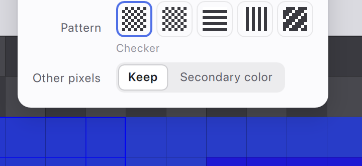

# Symmetry, dithering and shading

These are modifiers: they change how the drawing tools paint. **Shading**, **Dither** and **Symmetry** are in the options strip.

## Symmetry

The **Symmetry** button (two mirrored triangles) opens its popup:

- **Axes:** a vertical, a horizontal, and two diagonal mirror lines. Turn on any combination; combined axes mirror every way they make together.
- **Radial:** copies turned around the crossing point (2 or more). **Mirror** also mirrors each turned copy, and **Turn brush** turns square and custom brushes with each copy.
- **Center:** where the axes cross, in half pixels. **Center** puts them back through the middle of the canvas.

You can also drag the handles at the edges of the canvas. The button lights up while any axis is on.

## Dithering

Dithering paints through a pattern anchored to the canvas, so strokes line up with each other. Turn on **Dither**; the chevron next to it opens the settings:

- **Pattern:** Checker, Ordered (with a **Density** of 1 to 15 painted pixels in every 16), Horizontal lines, Vertical lines or Diagonal lines.
- **Other pixels:** what the unpainted pixels of the pattern do: **Keep** what was there, or paint the **Secondary color**.

It works with every tool that draws, including the fill. (Gradients have their own dither options.)

## Shading

**Shading** moves the colors under the brush one step along the palette:

- Left mouse: toward later colors in the palette. Right mouse: toward earlier colors.
- Other colors (not in the palette) stay.
- Shift-click swatches in the palette to pick a range; with no range, it shades along the whole palette.

Shading is available for the pencil, the line, and unfilled shapes.
