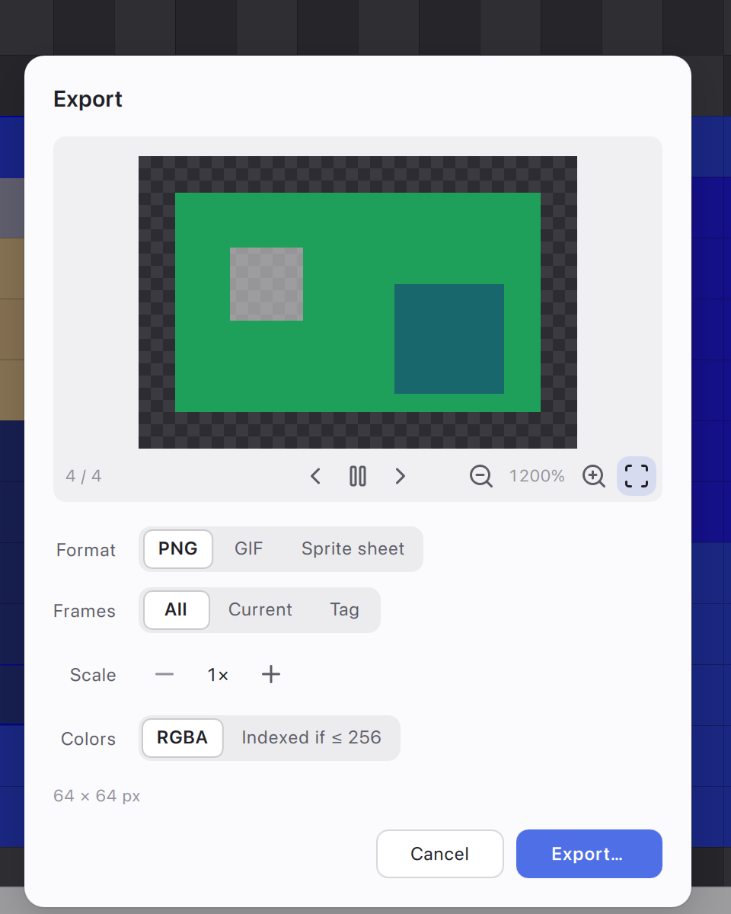

# Exporting: PNG, GIF and sprite sheets

**File → Export…** (<kbd>Ctrl</kbd> + <kbd>E</kbd>) opens the Export dialog. Its top shows a **live preview** with its own playback, zoom and an outline-each-frame toggle, so you can see exactly what you'll get.

## Options

| Option | Choices |
|---|---|
| **Format** | **PNG** (one image per frame), **GIF** (an animation), **Sprite sheet** (all frames in one image plus a `.json` file) |
| **Frames** | **All**, **Current**, or a **Tag** (only offered when the sprite has tags) |
| **Scale** | 1× up to 64×, with crisp, unsmoothed pixels |
| **Colors** | **RGBA**, or **Indexed if ≤ 256** to write an indexed PNG |
| **Layout** (sprite sheets) | **Row**, **Column**, **Grid**, or **By tag** (one row per tag, in tag order) |

A line under the options says what you'll get: for PNG, numbered files (`name-1.png`, `name-2.png`…) when there are several frames; for a sprite sheet, the image size and a `.json` with the frames and tags; for a GIF, that it loops, that alpha becomes on/off, and that frames get their own colors past 255.

Press **Export…** to choose where to save.

## Tips

- Hidden layers aren't exported.
- Your last choices are remembered between sessions.
- For games, a sprite sheet with **By tag** puts each animation on its own row; the JSON lists every frame's position and duration.
