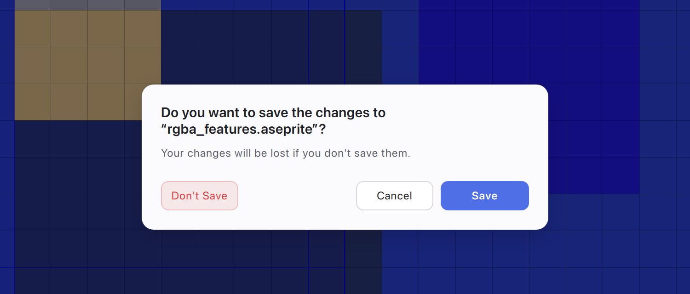
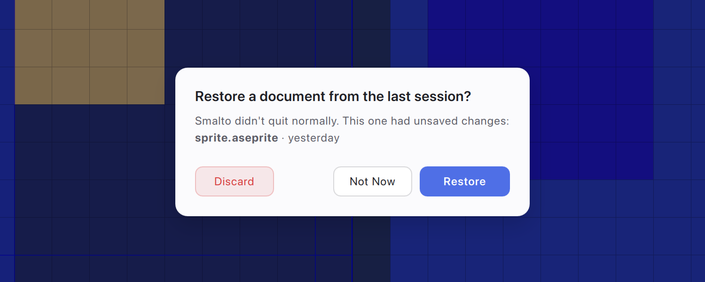

# Opening and saving

## Documents

Every open document is a tab. **File → New Sprite…** (<kbd>Ctrl</kbd> + <kbd>N</kbd>) and **Open…** (<kbd>Ctrl</kbd> + <kbd>O</kbd>) add tabs; they never replace what you have. **File → Open Recent** lists your last files, with **Clear Recent Files** at its end.

You can also open a file by double-clicking it in your file manager (when Smalto is registered for `.aseprite` files), or by choosing Smalto in **Open With**.

## Saving

Smalto saves **`.aseprite`** files (also `.ase`), the format used by Aseprite. It keeps layers, groups, frames, cels, tags, slices, tilesets and the palette. **Save** is <kbd>Ctrl</kbd> + <kbd>S</kbd>, **Save As…** is <kbd>Ctrl</kbd> + <kbd>Shift</kbd> + <kbd>S</kbd>. A new document asks where to save the first time.

A file is first written to a temporary name and then renamed, so a failed save doesn't damage the file you had.

To make a PNG, GIF or sprite sheet, use [Export](export.md), not Save.

## Unsaved changes

A dot on a tab means unsaved changes. Closing a tab (or quitting) with unsaved changes asks:

> Do you want to save the changes to "name"?

- **Save** (the accent button; it says **Save…** for a new document, which asks for a place) saves, then closes.
- **Don't Save** (red, on the left, away from the others) throws the changes away.
- **Cancel** (or <kbd>Esc</kbd>) goes back to your document.

Quitting with several unsaved tabs asks about each in turn; **Cancel** stops there.

## When Smalto quits unexpectedly

Smalto copies unsaved work aside a few seconds after you stop editing (15 seconds by default; **Preferences → Files → Crash recovery**). The next time you start it offers to bring those documents back:

- **Restore** opens the copies.
- **Not Now** keeps them for the next start.
- **Discard** (red) deletes them.

Your own files are never overwritten by a recovery copy. Restored documents come back without their undo history, and anything newer than the last copy is lost.

## Reopening your session

**Preferences → Files → Startup → Reopen files** opens the saved files that were open when Smalto last quit.

## Undo history

Every edit is undoable with <kbd>Ctrl</kbd> + <kbd>Z</kbd> (redo: <kbd>Ctrl</kbd> + <kbd>Shift</kbd> + <kbd>Z</kbd>). Big sprites with many edits can use a lot of memory, so the history is capped per sprite (256 MB by default; **Preferences → Files → Undo history**, 0 for unlimited). When it's over the limit, the oldest steps are forgotten; the latest step always stays.
