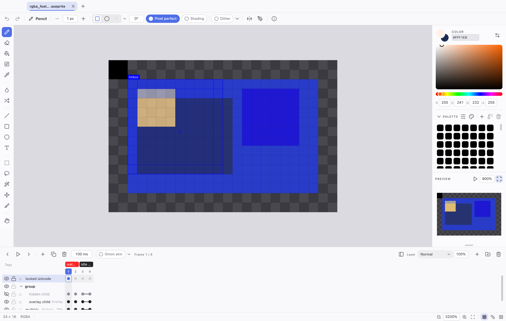

# A tour of the window

Smalto's window has a few regions. Each is described in more detail later in the manual.

## Tabs (top)

Every open document is a tab. Click a tab to switch, drag it to reorder, click its **×** (or middle-click it) to close it, and click **+** to start a new sprite. A dot on a tab means unsaved changes. Right-click a tab for **Close Others**, **Close Tabs to the Right** and **Reveal in Finder** (Show in Explorer on Windows).

On Windows and Linux the menus sit in a strip above the tabs. On macOS they are in the menu bar at the top of the screen.

## Options strip (under the tabs)

The strip under the tabs shows the options of the current tool. Left to right:

1. **Undo and redo.**
2. **The tool's name.**
3. **The tool's own options:** brush size, shape and angle, Pixel perfect, Shading and so on.
4. **Dither, Symmetry and Pen** (for every tool that draws).

The strip scrolls sideways if your window is narrow.

## Tool rail (left)

The tools, in groups separated by thin lines: drawing, brushes, shapes and text, selection and move, and the Hand. Hover a tool for its name and shortcut. You can ask for more than one column: drag the rail's right edge.

## Canvas (center)

Your sprite. Zoom with the wheel, a pinch or <kbd>+</kbd> / <kbd>-</kbd>; pan with <kbd>Space</kbd> and drag, the middle button or a two-finger scroll; <kbd>0</kbd> fits the sprite in the view.

## Side panels (right)

Color, palette and preview, in two columns you can rearrange. See [Panels and layout](../customizing/panels.md). The optional classic **Layers** list (<kbd>F8</kbd>) is another panel.

## Timeline (bottom)

A grid of layers (rows) by frames (columns). Playback, frame actions and onion skin are along its top; each layer's controls are in its left column. <kbd>Tab</kbd> hides and shows it.

## Status bar (very bottom)

On the left: the sprite's size, its color mode and the pixel under the pointer. On the right: zoom, fit to view, the pixel grid, the custom grid and the tiled view.
